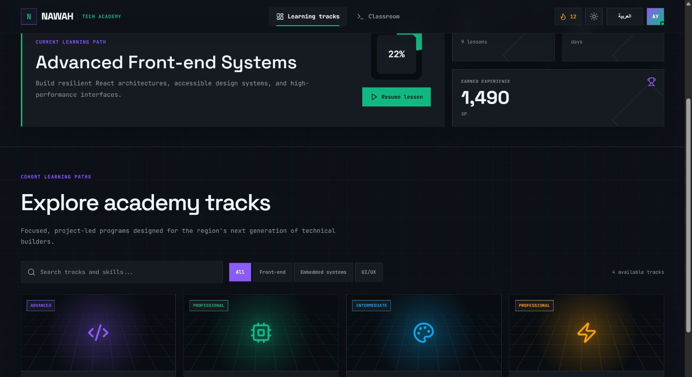

# NAWAH Tech Academy | أكاديمية نواة التقنية

A bilingual learning experience that connects course discovery with an interactive classroom, lesson completion, and locally saved progress. Designed around clear navigation, responsive layouts, and accessible RTL/LTR interactions.

[Live demo](https://eng-ayatnassar.github.io/nawah-tech-academy/) · [Source code](https://github.com/eng-ayatnassar/nawah-tech-academy) · [Ayat Nassar's portfolio](https://eng-ayatnassar.github.io/)



## Overview

Designed and developed by **Ayat Nassar** as a bilingual front-end portfolio project. The interface supports English and Arabic RTL, responsive layouts, and practical client-side interactions.

## Features

- Searchable course catalog and category filters
- Interactive classroom illustration and lesson navigation
- Lesson completion, XP indicators and local persistence
- Arabic RTL and English LTR layouts, light and dark themes

## Tech stack

React · JavaScript · Tailwind CSS · Vite

## Run locally

Requires **Node.js 22.12 or newer**.

```bash
npm ci
npm run dev
```

On Windows, you can also run `start.cmd`.

## Production build

```bash
npm run build
npm run preview
```

The build is written to `dist/`. Relative asset paths support deployment under a GitHub Pages repository path.

## Demo scope

**Frontend Demo.** Front-end demonstration. The player is illustrative and does not stream real video; learning progress is stored in the browser. Use fictional input when trying forms. External imagery and fonts depend on their providers.

## Deployment

The GitHub Actions workflow installs locked dependencies, checks known high-severity advisories, builds, and deploys to GitHub Pages on pushes to `main`. Pull requests run the build without deployment. Repository Pages settings use **GitHub Actions** as the source.

Source, lockfiles, and preview images are tracked. `node_modules/`, `dist/`, secrets, and local logs are excluded.

## بالعربية

تجربة تعليمية تربط استكشاف المسارات بفصل تفاعلي وتسجيل إنجاز الدروس وحفظ التقدّم محلياً، ضمن واجهة متجاوبة تدعم العربية والإنجليزية وتنقّلاً واضحاً بين المحتوى.

- بحث في المسارات وتصفية حسب التصنيف
- فصل تفاعلي توضيحي وتنقّل بين الدروس
- تسجيل الإنجاز ومؤشرات الخبرة وحفظ التقدّم
- واجهات عربية وإنجليزية ومظهر فاتح وداكن

هذا المشروع عرض Frontend لمعرض الأعمال، وليس خدمة تجارية متصلة بخادم أو نظام دفع أو حسابات حقيقية.
